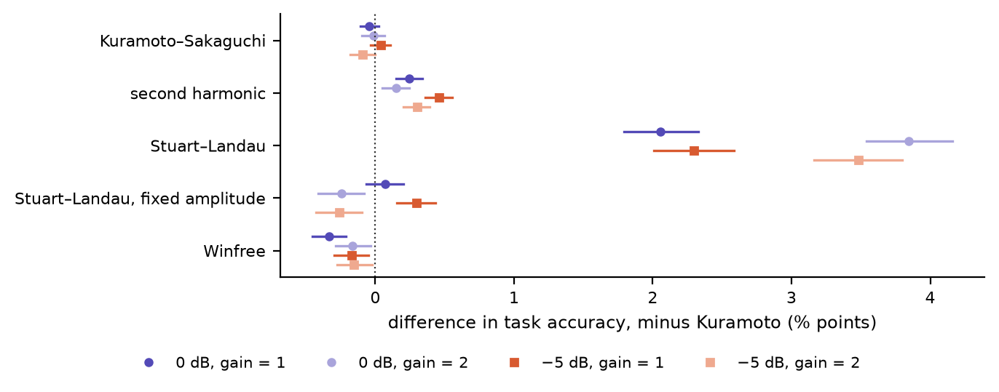
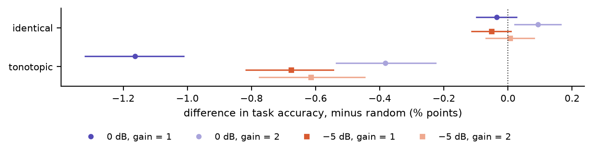
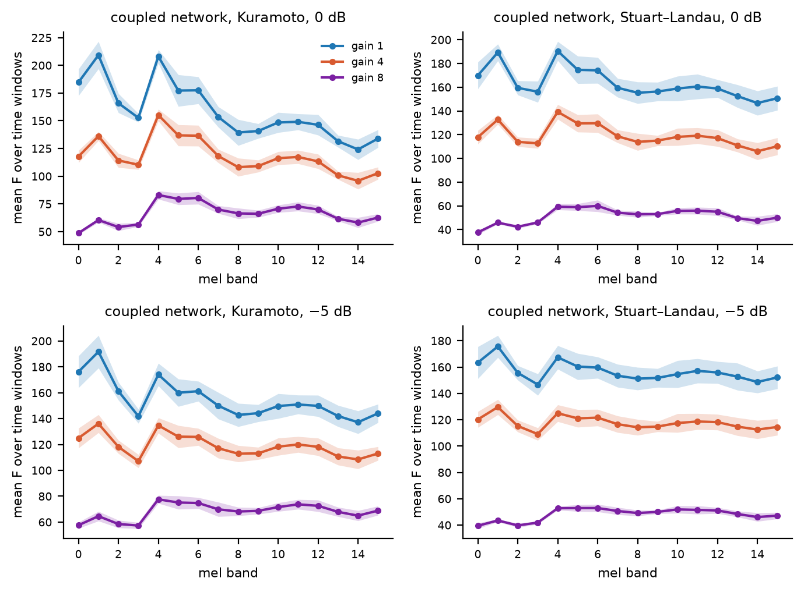

# Spoken-Digit Recognition Without Training: Geometry, Coupling, and Drive Effects in Oscillator Networks

## Abstract

Coupled-oscillator networks are gaining interest as a machine-learning substrate, on the premise that oscillator physics turns signals into useful structure, yet the ablations that would isolate what the dynamics contribute are rarely run. We run them for untrained coupled oscillator networks on spoken-digit recognition, on AudioMNIST with held-out speakers and white noise as loud as the speech and 5 dB louder. A network of 1,024 oscillators is read by a closed-form linear readout at a common width of 192 features and compared with the same readout on its input alone, the same network uncoupled, a leaky-integrator bank of the same size, an echo state network and a random oscillators network selected on validation speakers, and five trained networks of the same parameter count, across six coupling functions, eight lattice geometries, three kinds of natural frequencies, two input pathways and sweeps of gain, restoring strength, coupling ceiling, readout width and training size. Three findings. Most of the accuracy is the front end and the readout: in noise the untrained Kuramoto network reads within a point of its own spectrogram (77.8% against 78.0% at 0 dB) and below it on clean audio. What the dynamics add is memory: the network recovers most of what the input loses without its onset and carries the order of two digits that an order-free read of the input cannot, but a bank of leaky integrators does both, so the memory is integration rather than oscillation. The standard reservoirs read within 1.7 points of the input and a memoryless random expansion of it read 19 points below the input. A free amplitude, expressed in a Stuart–Landau oscillator network, is the one design factor that lifts the network above its input in noise, by 1.1 to 2.3 points, and holds its accuracy to an input gain of 8 where phase oscillators lose 15 to 19 points, a robustness that survives an exact-rotation drive step. Coupling function, lattice geometry and natural frequencies each move accuracy by less than a point. Among the untrained arms the echo state network reads highest on clean audio and matches the leaky-integrator bank on order, though it reads just below the input in noise. These results are the untrained baselines a trained oscillator network of this size should beat.

## 1 Introduction

The oscillation and synchronization recorded in neural populations as they track speech ([Assaneo et al. 2020](https://doi.org/10.1038/s41562-020-00962-0); [Doelling et al. 2023](https://doi.org/10.1371/journal.pcbi.1011669); [Pittman-Polletta et al. 2021](https://doi.org/10.1371/journal.pcbi.1008783); [Dogonasheva et al. 2026](https://doi.org/10.1016/j.neunet.2025.108194)) are consistent with neurons acting, in part, as coupled oscillators. We do not test that conjecture here. It motivates a narrower question: where are the useful boundaries of oscillatory neural networks, and what do their dynamics contribute?

A recent survey of oscillator networks in machine learning ([Kryski 2026](https://doi.org/10.2139/ssrn.7445198)) found the ablations that would answer that question largely missing: the coupling term had been removed as a single variable only three times, coupling functions had been compared only within the Kuramoto family ([Nunley 2026](https://arxiv.org/abs/2606.18694)). One graph network has since set Stuart–Landau against Kuramoto, without fixing the amplitude ([Zhang et al. 2026](https://doi.org/10.1145/3774904.3792675)). No study varied the lattice geometry or its boundaries as a single variable at a matched budget, and none contrasted different audio input structures under controls. We address those gaps on one task, spoken-digit recognition, where automatic speech recognition began ([Davis et al. 1952](https://doi.org/10.1121/1.1906946)) and a standard benchmark for oscillator reservoirs built in hardware ([Torrejon et al. 2017](https://doi.org/10.1038/nature23011); [Shougat et al. 2023](https://doi.org/10.1038/s41598-023-35760-x)). An untrained coupled oscillator network, read by a linear readout, is tested under six coupling functions and eight lattice geometries, among them a coil and a cochlea, and compared with the readout applied to its input alone, the same network uncoupled, leaky-integrator banks of the same size and five trained networks of the same parameter count, on AudioMNIST ([Becker et al. 2024](https://doi.org/10.1016/j.jfranklin.2023.11.038)) with held-out speakers and added noise. Untrained coupled oscillators have recognized spoken digits before, in simulation and on TI-46 with the same speakers in training and test ([Opala et al. 2019](https://doi.org/10.1103/PhysRevApplied.11.064029); [Coulombe et al. 2017](https://doi.org/10.1371/journal.pone.0178663)), and the two noisy AudioMNIST studies we found also share speakers ([Beoletto et al. 2026](https://doi.org/10.1002/aisy.202500526); [Young et al. 2026](https://doi.org/10.1186/s13636-026-00457-2)). To our knowledge none has been tested on held-out speakers with added noise against its input alone and its own uncoupled form.

The paper makes four contributions. First, a controlled ablation set for an untrained oscillator network, 6,353 runs over six coupling functions, eight lattice geometries, three kinds of natural frequencies, two input pathways and sweeps of gain, restoring strength, coupling ceiling, readout width and training size, each compared with controls that isolate the input, the readout's width, the memory and the coupling. Second, a speaker-disjoint, noisy AudioMNIST protocol with an order task that order-free readouts cannot solve. Third, the isolation of the oscillator's amplitude as the one design factor that lifts the network above its input in noise, by holding every other draw fixed and removing only that degree of freedom. Fourth, the standard reservoir baselines (an echo state network and a random oscillators network) with hyperparameters selected on validation speakers, a validation-selected configuration of the network itself, and two alternatives to the random projection, so that the comparison does not rest on one reader. Section 4 opens with the findings and presents each comparison as evidence for them.

## 2 Background

Coupled oscillators synchronize, form clusters, lock to a drive or split into coherent and incoherent domains, depending on how they are coupled and arranged ([Pikovsky et al. 2001](https://doi.org/10.1017/CBO9780511755743); [Strogatz 2000](https://doi.org/10.1016/S0167-2789%2800%2900094-4); [Kuramoto & Battogtokh 2002](https://arxiv.org/abs/cond-mat/0210694); [Abrams & Strogatz 2004](https://arxiv.org/abs/nlin/0407045)). Machine learning has used them two ways. Untrained, as reservoirs read by a trained linear readout ([Jaeger 2001](https://www.ai.rug.nl/minds/uploads/EchoStatesTechRep.pdf); [Maass et al. 2002](https://doi.org/10.1162/089976602760407955); [Tanaka et al. 2019](https://doi.org/10.1016/j.neunet.2019.03.005)): a spintronic oscillator recognized spoken digits in hardware ([Torrejon et al. 2017](https://doi.org/10.1038/nature23011)), though much of that accuracy came from its cochlear front end ([Abreu Araujo et al. 2020](https://doi.org/10.1038/s41598-019-56991-x)), whose authors therefore report a reservoir's gain over its front end alone and test it on held-out speakers in noise on another corpus. On AudioMNIST, a simulated network of 128 coupled protonic nickelate devices, a neuromorphic element that does not oscillate, read above the same network uncoupled and above a readout of the unprocessed input ([Zhou et al. 2026](https://doi.org/10.1038/s41565-026-02133-0)), which inspired one of the controls used in our study. Trained oscillatory neural networks (ONNs), structured as layers whose coupling or frequencies are learned, have been applied to various tasks: Neural Wave Machines, an oscillator lattice, on sequence classification and forecasting simple physical systems ([Keller & Welling 2023](https://proceedings.mlr.press/v202/keller23a.html)), AKOrN on unsupervised object discovery, adversarial robustness, uncertainty calibration and Sudoku ([Miyato et al. 2025](https://openreview.net/forum?id=nwDRD4AMoN)), WONN on image recognition, Sudoku and maze solving ([Dai & Song 2026](https://arxiv.org/abs/2605.20922)), FSN on character-level language modelling ([Nunley 2026](https://arxiv.org/abs/2606.18694)), Un-0 on image generation ([unconv.ai 2026](https://unconv.ai/blog/introducing-un-0-generating-images-with-coupled-oscillators/)) and coupled oscillatory recurrent networks, coRNN ([Rusch & Mishra 2021](https://openreview.net/forum?id=F3s69XzWOia)), one of which reached 89% on AudioMNIST from the raw waveform with a random, not speaker-disjoint, split ([Chandravadia & Imam 2026](https://doi.org/10.1016/j.patter.2026.101563)). Most adopt one coupling function and one arrangement, and the survey found that few share a benchmark, AKOrN and WONN on Sudoku among them, and fewer share a protocol ([Kryski 2026](https://doi.org/10.2139/ssrn.7445198)). Here one task is held fixed and the coupling function, the geometry and the input are varied across it, on untrained networks, so that each can be compared with controls in future training experimentation.

## 3 Methods

### 3.1 Design

This study asks whether an untrained coupled oscillator network carries information for recognizing spoken digits beyond its input alone, beyond a non-oscillating memory of the same size and beyond the same oscillators uncoupled; how trained networks of the same parameter count compare; whether the coupling function, lattice geometry, natural frequencies, restoring strength, coupling ceiling, input pathway and input gain change the answer; how the answer changes with the readout's width and the training data; and whether an untrained network can _remember_ the order of events. It ran as eight experiments, 6,353 runs, each one arm at one noise level, input gain and seed, every condition at three seeds. The code and every run's record are in the supplementary material, and Appendix A defines every term.

Every oscillator network is 4 channels of a 16 × 16 lattice, 1,024 oscillators, and each oscillator's phase evolves as θ̇ᵢ = ωᵢ + couplingᵢ + g·uᵢ − λ sin θᵢ: its natural frequency, the coupling from the other oscillators of its channel through a random kernel whose spectrum is capped at the _coupling ceiling_, the input at gain g, and a restoring pull of strength λ. Row r of every channel is driven by mel band r. The six coupling functions (Kuramoto, Kuramoto–Sakaguchi, second harmonic, Winfree, and Stuart–Landau with and without its amplitude) differ only in the coupling term, and a lattice geometry changes only which oscillators are neighbours (see Appendices B and C). The reference configuration is Kuramoto coupling on the torus with random natural frequencies, restoring strength 0.3 and coupling ceiling 1. Kuramoto is the reference coupling because it is the most widely used in the prior art, and the torus the reference geometry because it wraps in both directions, so no oscillator sits at an edge. The configuration was fixed in advance and then checked by a calibration on validation speakers (noise levels, gain, restoring strength and coupling ceiling), with which it largely agrees (Appendix F). Section 4.8 reports the configuration that calibration selects beside it. Appendix E gives every reservoir's discrete update, solver, time step and initial state.

The arms compared with it are the **spectrogram-only baseline**, the readout applied directly to the input; the **uncoupled oscillator network**, the same network with its coupling kernels set to zero; two untrained **leaky-integrator banks**, one matched to the network's 1,024 states and 2,048 parameters and one to its 2,048 exposed signals; and five **trained baselines** (GRU, a dilated residual TCN, CNN, transformer and S4D) of 1,840 to 2,109 parameters, trained end to end (AdamW, 30 epochs) through a learned linear layer on the same statistics the readout reads, standardized. The four untrained dynamical arms are the reservoirs. Three **reservoir baselines** of the same state count complete the comparison (Appendix G): a leaky echo state network, the random oscillators network of [Ceni et al. 2024](https://proceedings.mlr.press/v238/ceni24a.html), each with hyperparameters selected on validation speakers, and a memoryless random nonlinear expansion of the input.

### 3.2 Task, data and noise

We perform single-digit audio classification over AudioMNIST ([Becker et al. 2024](https://doi.org/10.1016/j.jfranklin.2023.11.038)), which holds 30,000 recordings of digits 0 through 9 by 60 speakers. Every result keeps speakers apart to avoid a model overfitting to a particular speaker's vocal spectrogram. Under Protocol A the arms train on speakers 1 to 48 and test on all 6,000 recordings of speakers 49 to 60, an 80/20 split by speaker, with training sets of 2,048 clips (8,192 and 24,000 in the training-size comparison). Wherever a configuration or a hyperparameter is selected (the calibration of the reference, the selected network and the reservoir baselines), speakers 41 to 48 are held out of training as validation speakers, so nothing is selected on the test speakers (Appendix F). Under Protocol B the arms follow Becker et al.'s five speaker folds (60/20/20). Because the clean task nearly saturates, white noise is added to every clip at signal-to-noise ratios of 0 dB (as loud as the speech) and −5 dB (5 dB louder), the levels at which [Young et al. 2026](https://doi.org/10.1186/s13636-026-00457-2) trained hybrid real and complex-valued convolutional networks on AudioMNIST, though they did so on a random audio sample split so were not speaker disjoint. We also report clean audio for reference. Additionally, we performed an order task on five different digit pairs where two digits of a pair are spoken one after the other and the arm must say which came first. Statistics of an input read over the whole span cannot tell the orders apart, so the spectrogram-only baseline reads chance, 50%. Every arm hears the same fixed front end, a 16-band log-mel spectrogram at 62.5 frames per second, without training on this task besides the single-digit training methodology.

### 3.3 Readout

Every arm is read the same way (Appendix D.1 draws the readout for each kind of arm). Each of its signals (a band energy, the sine or cosine of an oscillator's phase, a leaky integrator's state or a trained baseline's hidden unit) is summarized by its mean, standard deviation and mean absolute change over each of four equal windows of frames 16 to 61, after a 16-frame warm-up (frames 16 to 147 as one window for the order task). So that readout capacity cannot obscure dynamics, every arm is read at the same width, 192 standardized features. That is exactly the spectrogram-only baseline's own number of features (16 mel bands by 3 statistics by 4 windows), so the input is read without compression, and it is the native width of four of the five trained baselines. Arms with more features, the reservoirs (12,288 to 24,576) and the GRU (216), are projected down to 192 by a random Gaussian matrix ([Johnson & Lindenstrauss 1984](https://doi.org/10.1090/conm/026/737400)). Arms with fewer features, the baseline and the trained baselines on the order task (48 to 54), are read as they are. The features are classified by one linear layer fitted by ridge regression in closed form, the reservoir-computing standard ([Jaeger 2001](https://www.ai.rug.nl/minds/uploads/EchoStatesTechRep.pdf); [Lukoševičius 2012](https://doi.org/10.1007/978-3-642-35289-8_36)) and the weakest reader that can be fitted identically for every arm. The projection matrix is drawn once from a fixed seed and serves every run of the same native width, so the spread over seeds leaves out the projection's own randomness. The controls experiment's reservoirs are also read through a matrix drawn from each run's seed. The spectrogram-only baseline is read over the whole clip, its primary form, and from frame 16, the frames every other arm is read over. Section 4.8 reads the reservoirs two more ways at width 192, through a PCA fitted on the training clips and through a structured pooling within each lattice row, so that the conclusions do not rest on one random matrix.

### 3.4 Input pathways and gain

The audio drives a reservoir in one of two ways: the **spectrogram** pathway adds each band's energy to the rotation rate of its row's oscillators, and the **quadrature** pathway adds a phase-referenced push g·Aᵣ sin(φᵣ − θᵢ), the injection form of [Adler 1946](https://doi.org/10.1109/JRPROC.1946.229930), so an oscillator can lock to its band's own cycle. Only the coupled networks run on the quadrature pathway, beside its own spectrogram-only baseline, which reads the quadrature front end directly: a leaky integrator has no phase for the push to act on, the trained baselines take the input as features rather than as a drive, and the uncoupled network was left out because the question is whether coupled oscillators can use a phase-referenced drive at all. Input gain scales the input into a reservoir. It is run at gains of 1 and 2 throughout and swept from 0.25 to 12 for the reference configuration of each coupling function, below the integrator's bound ([Hairer et al. 1993](https://doi.org/10.1007/978-3-540-78862-1)). The spectrogram-only baseline and the trained baselines do not have gain applied because the readout's standardization removes any fixed scale from the directly read spectrogram input, and the trained models learn their own.

### 3.5 Reporting

Every task accuracy result reported is the mean over replicates (three seeds; five folds under Protocol B) ± the sample standard deviation, and every comparison between two arms is paired on the same test clips, condition and seed, reported as the mean difference ± its standard deviation over seeds and a 95% interval from 2,000 paired bootstrap resamples of the test clips. Every comparison is reported at the primary cell, the four-window read at 2,048 training clips and readout width 192, unless it says otherwise.

## 4 Results

**Findings.** Three findings organize the comparisons below. (1) Most of every arm's accuracy comes from the front end and the readout: at the common width the untrained Kuramoto network reads within a point of its own spectrogram in noise and 2.5 points below it on clean audio (Section 4.1), and the input's format matters more than the network's design, since the same networks read near chance on the quadrature pathway (Section 4.6). (2) What the dynamics add is memory. Read only after its warm-up, the network recovers most of what the input loses without its onset, and it carries the order of two digits that an order-free read of the input cannot see (Section 4.2). A leaky-integrator bank of the same size does both, so the memory is integration, which oscillation also performs, rather than oscillation itself. Coupling adds about a point on noisy recognition and 2 to 19 points on order. (3) A free amplitude is the one design factor that lifts the network above its input in noise, by 1.1 to 2.3 points, and the one that keeps its accuracy as the input gain rises (Sections 4.3 and 4.5). The coupling function, the lattice geometry and the natural frequencies each move accuracy by less than a point (Sections 4.3 and 4.4). Section 4.7 shows what the common width costs, and Section 4.8 sets the network beside the standard reservoir baselines, a configuration selected on validation speakers, and two other readers.

### 4.1 The network against its controls and the trained baselines

Figure fig01-sec4-1-recognition-arms shows every arm at the primary cell, and the supplementary material gives the tables. The spectrogram-only baseline read 93.6%, 78.0% and 71.6% on clean audio, at 0 dB and at −5 dB, and the Kuramoto network at gain 1 read 91.1%, 77.8% and 70.7%. That is within a point of its input with noise (−0.23 [−0.99, +0.52] at 0 dB, −0.88 [−1.66, −0.09] at −5 dB) and 2.5 points below it on clean audio, but 7.5 to 15.9 points above the input read over the same frames, from frame 16. Coupling added 0.4 to 1.1 points over the uncoupled network. The state-matched leaky-integrator bank read about 4 points below the network with noise and 2.4 above it on clean audio. The Stuart–Landau network read level with its input on clean audio and above it in every noisy condition (80.3% and 73.0% at gain 1; Section 4.3). With noise every trained baseline read above the Kuramoto network, the GRU highest at 82.8% and 76.9%, with the Stuart–Landau network in their range. On the speaker folds of [Becker et al. 2024](https://doi.org/10.1016/j.jfranklin.2023.11.038) (clean, 18,000 training clips), the baseline read 96.0 ± 1.7%, the network 91.9 ± 3.1% (96.9 ± 1.3% at width 4,096) and the trained baselines 97.0% to 98.4%, against 95.8% reported for AlexNet on spectrograms.

### 4.2 Temporal order

Figure fig02-sec4-2-order-arms shows every arm on the two digit ordered classification task, averaged over the five digit pairs, and the supplementary material gives the table. The spectrogram-only baseline read 49.8% to 50.6% on the order task in every condition. The Kuramoto network read 97.7%, 96.2% and 95.5% at gain 1 (clean, 0 dB, −5 dB), 45.4 to 47.9 points above it. Uncoupled, it read 2.2 to 8.5 points lower at gain 1 and 10.4 to 18.7 points lower at gain 2. Both leaky-integrator banks read 98.7% to 99.9%, 2.2 to 7.5 points above the network. Every trained baseline but the CNN read 91% or more. The CNN read 92.2% on clean audio and chance with noise: its two convolutions see 9 frames (144 ms), less than a digit, so with no memory beyond that window it can tell the orders apart only where one digit meets the other, a cue the noise masks.

### 4.3 Coupling function

The design experiment crossed six coupling functions, six lattice geometries, three kinds of natural frequencies, two restoring strengths and two coupling ceilings (the Stuart–Landau functions on the torus only), 312 configurations at 0 and −5 dB, gains 1 and 2 and three seeds, each level paired with its reference over every configuration matching it in the other factors (Figure fig03-sec4-3-coupling-functions). The **Stuart–Landau** network, whose oscillators have a free amplitude, read 2.1 to 3.8 points above its Kuramoto match, the largest difference in the experiment, and at the reference configuration it read above the whole-clip baseline in all four noisy conditions, by 1.14 to 2.31 points with every interval above zero. With its amplitude fixed it read within 0.3 points of Kuramoto. The other phase coupling functions differed from Kuramoto by at most 0.46 points. On clean audio it read 2.8 points above Kuramoto at gain 1 and 6.1 at gain 2 and level with the input, and with its amplitude fixed within 0.1 points of Kuramoto, so the amplitude's lead over the phase network is larger clean than in noise while its lead over the input appears only in noise.

### 4.4 Lattice geometry and natural frequencies

Every **lattice geometry** in the design experiment read within 0.65 points of the torus, the sphere and sheet lowest (Figure fig04-sec4-4-lattice-geometries, Appendix C). A **coil**, one open line from base to apex with one octave per turn, read within 0.22 points of the torus. A **cochlea**, the coil with coupling three times as strong from base to apex as back and growing with the coil's curvature toward the apex, read 0.41 to 0.97 points below the torus. Part of that gap is the cochlea's weaker coupling: capping its curvature weights at the apex halves its average coupling, and a control at the coil's average coupling read 0.28 to 0.71 points above the cochlea, yet 0.40 to 0.47 points below the coil at gain 1 and within 0.12 points of it at gain 2.

Each oscillator's **natural frequency** is its rate of rotation when nothing acts on it. The reference draws each at random with mean 1 and standard deviation 0.1, unrelated to the band that drives it. **Tonotopic** frequencies order the rates by band, as the cochlea orders pitch by place: the rate rises a quarter octave per row, from 0.41 in the row of the lowest mel band to 5.5 in the highest, jittered by 5%. **Identical** frequencies set every rate to 1. Tonotopic frequencies read 0.38 to 1.16 percentage points below random ones, and identical ones within 0.1 (Figure fig05-sec4-4-natural-frequencies, Appendix C).

### 4.5 Restoring strength, coupling ceiling and gain

A restoring strength (the pull toward phase 0) of 0.1 read 0.13 to 0.23 points below 0.3, and a coupling ceiling of 0.5 read 0.39 to 0.68 points below 1. A sweep beyond these levels, for every coupling function at the reference configuration, moved accuracy by at most 2.8 points (Figure fig06-sec4-5-restoring-ceiling-gain). Gain separates the Stuart–Landau network from the rest. From gain 1 to gain 8 it lost 4.3 points at 0 dB and 2.8 at −5 dB, while every phase-oscillator network lost 15 to 19 points and the Stuart–Landau network with its amplitude fixed 25 to 28. Beyond gain 8 it also gave way, losing 20.8 points by gain 12 at 0 dB. Below gain 1 the order reverses: at gains 0.25 and 0.5 the phase-oscillator networks read 0.3 to 2.5 points above gain 1 and the Stuart–Landau network 0.7 to 1.7 points below it, which brings the best phase network within 0.8 points of the Stuart–Landau network at gain 1 at 0 dB and level with it at −5 dB.

The fixed-amplitude network's fall below Kuramoto at high gain has a numerical cause. The Stuart–Landau update applies the input inside a semi-implicit step that rotates the state by 2·arcsin(h/2) per frame rather than h, with h = dt × gain × input (Appendix E). The error is within 0.4% at gains 1 and 2, where the two agree, but 7% by gain 8 and 24% by gain 12. The exact-drive experiment reruns both Stuart–Landau networks with the input applied as an exact rotation at every gain (dashed in Figure fig06-sec4-5-restoring-ceiling-gain). With the exact drive the fixed-amplitude network reads within 0.8 points of Kuramoto at every gain, and the free-amplitude network loses only 2.5 points from gain 1 to gain 8 at 0 dB and 1.1 at −5 dB, where the fixed-amplitude network loses 17.6 and 15.2. The free amplitude's robustness to gain is the oscillator's and not the integrator's.

### 4.6 Quadrature pathway

The quadrature experiment ran ten networks on the quadrature pathway (the four phase coupling functions on the torus, and Kuramoto on the helix, each with random and with tonotopic natural frequencies) at 0 and −5 dB, gains 1 and 2 and three seeds. All ten read 11.7% to 15.1%, near the chance level of 10% and 55.7 to 66.0 points below the same networks on the spectrogram pathway, while the spectrogram-only baseline read on the quadrature front end reached 36.1% at 0 dB. In no run did more than 0.3% of the oscillators lock to their band.

### 4.7 Readout width and training data

Widening the readout to 1,024 and 4,096 features raised nearly every arm with more than 192 features to read, the Kuramoto network by up to 3.8 points at gain 1 (6.3 at gain 2) and the leaky-integrator banks by up to 6.2, and left the 192-wide arms unchanged (Figure fig07-sec4-7-readout-width, Appendix D.1). From 2,048 to 24,000 training clips, at width 192 and with noise, the spectrogram-only baseline gained 3.5 to 4.1 points, the Kuramoto network 2.0 and the trained baselines 7.1 to 12.4, since they learn through their networks as well as their readout. At width 4,096 the Kuramoto network read above the whole-clip spectrogram-only baseline at every training size, and with 2,048 clips at 0 dB above the S4D, CNN and transformer (81.4% against 79.2% to 80.8%). With 8,192 or 24,000 clips every trained baseline read above every reservoir at every width with noise. Read through a projection drawn from each run's seed instead of the fixed one, the reservoirs moved by −1.3 to +1.2 points and every paired comparison kept its sign.

### 4.8 Reservoir baselines, model selection and the projection

The echo state network and the random oscillators network, at the hyperparameters the validation speakers selected (Appendix G), read like arms already in the study (Figure fig13-sec4-8-reservoir-baselines and the table in Appendix G). The echo state network is the best untrained arm on clean audio, 95.3% against the input's 93.6%, and matches the leaky-integrator bank on order (98.9% to 99.9%). In noise it reads 77.2% at 0 dB and 70.9% at −5 dB, just below the input, as the Kuramoto network does. The random oscillators network reads 79.3% and 73.3% in noise, above the input and in the Stuart–Landau network's range, but 87.9% on clean audio. The memoryless random nonlinear expansion of the input reads 18 to 20 points below the input in noise and chance on order. So what the reservoirs add to the input is memory, not more nonlinear features of the same frame, and the standard reservoirs add no more of it than the lattice does.

Selected on the validation speakers (Appendix F), the Kuramoto network's configuration reads 78.8% and 72.5% on the test speakers, 1.3 and 1.5 points above the reference trained on the same speakers. The Stuart–Landau network's selection reads half a point below its reference at 0 dB and is the reference itself at −5 dB. The selected Kuramoto network still reads below the Stuart–Landau network at its reference.

Read through a PCA fitted on the training clips instead of the random matrix, the coupled networks and the banks gain 1 to 3.6 points in noise, and the comparisons that decide the paper read as they do through the random matrix: at gain 1 the coupled network reads 2.5 and 2.4 points above the uncoupled network (0 and −5 dB) and the Stuart–Landau network 2.0 and 2.2 above Kuramoto. Through the within-row pooling, which averages the 128 signals of a row into one number per statistic and window, the differences shrink, and the Stuart–Landau network's lead remains only at gain 2 (2.6 and 3.4 points). So what coupling and the amplitude add is carried partly by structure within a row, between channels, columns or sine and cosine, that a random matrix and a PCA both keep and an average over the row removes (Appendix D).

## 5 Discussion and conclusion

**What the dynamics add.** Finding 2 rests on three observations. A Kuramoto oscillator's phase advances at its natural frequency plus its drive, so, apart from the restoring pull and the coupling, its phase is the running sum of its band's energy wrapped around the circle. A leaky integrator keeps a running average of the same energy. Because an integrator's state at each moment depends on what came before, statistics of that state over the audio clip differ with the order of its inputs, where the same statistics of the input do not. That is why both remember order and the input alone cannot. Coupling also moves information across the lattice: read through only its upper eight rows, the coupled network reads 28 to 31 points above the uncoupled one, whose upper rows carry no more than the input's upper bands (Appendix D.2). The analysis of variance per band and time window (Appendix D.2, Figures fig11-appD2-class-information and fig12-appD2-class-information-seeds) shows the input's class information peaking at the onset and every reservoir carrying it into later windows. The results align with the reports that much of a reservoir's accuracy is its front end, for a spintronic oscillator on TI-46 ([Abreu Araujo et al. 2020](https://doi.org/10.1038/s41598-019-56991-x)) and for a piezoelectric reservoir on AudioMNIST, which matched logistic regression on its input ([Buckley et al. 2026](https://arxiv.org/abs/2604.00207)).

**Network design.** A free amplitude is where the design effect sits, not the Stuart–Landau coupling form: with its amplitude fixed, the network reads like Kuramoto. On graphs, a Stuart–Landau network also reads above its Kuramoto counterpart ([Zhang et al. 2026](https://doi.org/10.1145/3774904.3792675)), but there the two are separately built and trained networks whose coupling, parameters and training all differ. Here the fixed-amplitude variant is the free one with the same random kernel, natural frequencies, initial state, input, solver and readout and one degree of freedom removed, so the contrast isolates the amplitude. Four experiments in Appendix D.2 say in part why the amplitude helps. Read through its amplitude alone (|z| per oscillator, half the features), the Stuart–Landau network keeps its whole lead over Kuramoto, and read through its phase alone it loses most of that lead, so what the readout gains is the amplitude itself as a signal. The gain sits in the upper rows, which receive only a noise-dominated drive and are driven mainly by their neighbours: read one band at a time, they are the best single-band readouts of any arm in noise (51% at 0 dB against 44% for Kuramoto's rows and 25% for the input's own upper bands). The amplitude need not be slow, since a network whose amplitude relaxes sixteen times faster reads the same at gain 1. Our reading is that the radial equation makes each oscillator's radius a record of the radial force on it: the coupling's pull toward its neighbours' mean, large and inward when the oscillator is out of step with them, and the restoring pull toward phase 0. The readout then receives each oscillator's local coherence as a signal, which a phase network cannot expose. A Kuramoto network read with an amplitude slaved to its own phases recovers about half of the lead at gain 2 and little at gain 1, so the amplitude's feedback on the phases carries the rest, and that part is not yet explained. The per-feature class-information maps (Figures fig11-appD2-class-information and fig12-appD2-class-information-seeds) do not track this accuracy, and Appendix D.2 says why. Among phase oscillators the coupling function and the geometry each moved accuracy by less than a point, and a coil and a cochlea, built to follow the cochlea's shape and mechanics, read no better than the torus.

**Readout.** With noise, more training data raised every arm, the trained baselines three to six times as much as the Kuramoto network, since in a reservoir only the readout learns. The common width of 192 favours the input: it reads the spectrogram's 192 features whole but compresses a reservoir's 12,288 to 24,576 features by 64 to 128 times through a random projection, which keeps the distances between clips only roughly at so few dimensions ([Johnson & Lindenstrauss 1984](https://doi.org/10.1090/conm/026/737400)). Read at 4,096, the coupled network and the leaky-integrator banks at gain 1 pass their input, but their readout then fits 40,970 weights against the 1,930 that read the input, so some or all of the improvement could be the extra weights. The fair comparison is at the common width. Section 4.8 shows that the comparisons read the same through a PCA fitted on the training clips, while a pooling that averages each lattice row keeps the Stuart–Landau lead only at gain 2. The conclusions therefore do not rest on one random matrix, though they do rest on a reader that sees within a row.

**Data and training.** Many published spoken-digit results share speakers between training and test, among them both noisy AudioMNIST studies ([Beoletto et al. 2026](https://doi.org/10.1002/aisy.202500526); [Young et al. 2026](https://doi.org/10.1186/s13636-026-00457-2)) and the TI-46 reservoirs ([Torrejon et al. 2017](https://doi.org/10.1038/nature23011); [Opala et al. 2019](https://doi.org/10.1103/PhysRevApplied.11.064029); [Coulombe et al. 2017](https://doi.org/10.1371/journal.pone.0178663)). A classifier there, a trained network or a readout alike, can learn the test speakers' voices, which likely raises its accuracy, so those results are not comparable with ours. Training is the step these results leave open, and the same controls can say where it helps: a learned encoder, a learned decoder in place of the random projection, or trained coupling and natural frequencies, each set against the uncoupled network, the bank and the input alone at the same number of trained parameters. A trained coupled-oscillator network reaches 89% on AudioMNIST from the raw waveform ([Chandravadia & Imam 2026](https://doi.org/10.1016/j.patter.2026.101563)), on a random split. Run through these controls on held-out speakers, it would show what its oscillators contribute.

**Future directions.** The input's format decided more than the network's design, so other formats should be tested, such as MFCCs, cochleagrams or a resonator's tonogram, on which a linear readout reached about 98% in hardware against 75.5% for a spectrogram, with shared speakers ([Beoletto et al. 2026](https://doi.org/10.1002/aisy.202500526)). An untrained network also runs causally, so with a streaming readout it could suit low-power, real-time audio, which our clip-pooled readout leaves untested.

**Scope.** The conclusions are about one front end (a 16-band log-mel spectrogram at 62.5 frames per second), one network size (1,024 oscillators in four 16 × 16 channels), one readout family (ridge on three time-pooled statistics per signal, at a common width) and one task family (isolated spoken digits and their order, in white noise, on held-out speakers). Within that scope they are controlled: every comparison holds everything but one factor fixed. Beyond it they are hypotheses. A richer front end could leave the reservoir less to add or more. A larger lattice or a trained coupling could change what coupling contributes. A streaming or nonlinear readout could read structure these statistics discard, and other corpora, noises or tasks could move the balance between input, memory and dynamics. The standard reservoir baselines of Section 4.8 say how the untrained oscillator network stands against the generic alternatives at this size, which is what a trained oscillator network of the same size should be measured against.

**Limitations.** Three seeds give a spread but not a precise estimate of it. The readout is one structure, a ridge on three statistics per signal. The trained baselines are matched at about 2,000 parameters and share one training recipe rather than one tuned to each architecture, so each might read higher with a different training regime.

**Conclusion.** Untrained and read at a common width, a coupled oscillator network classifies noisy spoken digits from held-out speakers about as well as its own input and carries the order of events by integrating it, as a leaky-integrator bank does. Coupling adds to both tasks, a free amplitude lifts the network above its input in noise, and the lattice geometry and phase coupling function each move it by less than a point. An echo state network of the same size is the strongest untrained arm on clean audio and, level with the bank, on order, but it reads just below the input in noise. Small trained networks read higher with noise, the Stuart–Landau network alone reaching their range, and these results are the baseline a trained oscillator network of similar size should beat.

## Reproducibility statement {-}

The code and the complete run record (every run's specification, results and per-clip correctness) are in the anonymized supplementary material and will be released with the paper. AudioMNIST is public ([Becker et al. 2024](https://doi.org/10.1016/j.jfranklin.2023.11.038)). Scripts and a README with instructions on how to reproduce the data and figures are included in the supplementary material. Every run records its code version, hardware and library versions. The leak check and the controls and design experiments ran on the CPU of an Apple M1 Max, where runs with the same seed are bit-identical. The later experiments simulated the reservoirs on its GPU, which reproduced 1,262 of 1,296 of the controls experiment's cells exactly and all but one within two test clips (the record's summary.md). The trained baselines train on the CPU on every device. Rerun on an x86 CPU with an NVIDIA GPU, 28 of the recorded runs, one of every arm, coupling function and lattice geometry, reproduced the untrained arms within two test clips and the trained baselines within their spread over seeds. The experiment harness has been set up to be able to be run on NVIDIA GPUs and Apple Silicon in a Linux or macOS environment. We welcome reproductions.

## AI use statement {-}

This work was carried out by the authors working with an AI coding agent, Claude (Anthropic), for the following purposes:

**Implementing code and tests.** Under the authors' direction the agent wrote most of the experiment harness and the test suite. The authors verified and independently reviewed, refactored and ran the code.

**Refining experiments and summarizing results.** The authors set the research questions and directed the work. The agent contributed to flagging flaws in experimental designs, and wrote first-draft interpretations of raw result data, which the authors reviewed and accepted, revised or rejected.

**Drafting.** The agent drafted sections of this paper and assisted in finding and checking correct citation format of related literature. The authors independently verified, reviewed and revised, where appropriate, all citations and referenced literature.

The authors take responsibility for the final content of this work.

## Ethics statement {-}

This work uses AudioMNIST, a public corpus of spoken digits released under the MIT licence. We use nothing about its speakers beyond their anonymous voice recordings, numbered by speaker so that training and test keep speakers apart, and the audio examples in the supplementary material are clips from it, shipped with its licence. No new data was collected, and every experiment ran on a single Apple M1 Max computer.

<!-- appendix -->

## Appendix {-}

## A Glossary

The terms as this paper uses them. The code and the run record keep their own labels. *src/README.md*, in the supplementary material, maps each term to its label.

### A.1 The pipeline

| Term | As used in this paper |
|---|---|
| **Front end** | The fixed first stage every arm shares. It turns a clip's 16 kHz waveform into a mel spectrogram: a 512-point Fourier transform every 256 samples (16 ms), 16 mel bands, the log of each band's energy, and a fixed rescaling. Nothing in it is trained or fitted to the data. Each recording is first resampled from 48 kHz to 16 kHz, peak-normalized, trimmed of leading and trailing silence below 1% of its peak and capped at 1 s. |
| **Mel band** | One of the 16 frequency ranges the front end splits the audio into, spaced on the mel scale, which follows pitch perception: narrow at low frequencies, wide at high ones. |
| **Band energy** | The log energy in one mel band, one value per frame: the signal the front end produces for that band. |
| **Mel spectrogram** | A clip's 16 band energies together, frame by frame. The spectrogram-only baseline reads it directly. Every reservoir is driven by it. |
| **Frame** | One 16 ms step of the front end, 62.5 per second. |
| **Reservoir** | An untrained dynamical system between the front end and the readout: here the coupled and uncoupled oscillator networks and the two leaky-integrator banks. The term is reservoir computing's ([Jaeger 2001](https://www.ai.rug.nl/minds/uploads/EchoStatesTechRep.pdf); [Maass et al. 2002](https://doi.org/10.1162/089976602760407955)). |
| **Readout** | The reader shared by every arm, and the only fitted part of an untrained arm: one linear layer from 192 features to 10 digit scores (1,930 weights), fitted by ridge regression, that is least squares with an L2 penalty, solved in closed form. The penalty is chosen from four values on the last eighth of the training clips, then the readout is refit on all of them. It is the same for every arm, so it is held constant across comparisons. |
| **Untrained** | Parameters drawn at random once, from the seed, and never updated. In an untrained arm only the readout is fitted. |
| **Input gain** | The factor that scales the input before it drives a reservoir: 1 or 2. It applies only to the reservoirs: the spectrogram-only baseline has no dynamics for it to act on, and a trained baseline learns its own input scale. |
| **Input pathway** | How the audio drives a reservoir. Spectrogram: each band energy of the mel spectrogram adds to the rotation rate of the oscillators in its row. Quadrature: each band's energy and phase, so the push depends on where an oscillator is relative to the band's own cycle, a phase-referenced drive of the kind [Adler 1946](https://doi.org/10.1109/JRPROC.1946.229930) analysed. |

### A.2 Arms and baselines

| Term | As used in this paper |
|---|---|
| **Arm** | One system under comparison, read the same way as every other. The term comes from experimental design. |
| **Spectrogram-only baseline** | The front end and the readout with nothing between them: the readout reads the band energies directly, so it measures what the input alone supports. Read from the first frame, over the whole clip, it is the primary control, because it sees everything a reservoir is driven with. Read from frame 16, it sees the frames every other arm is read over. On the quadrature pathway it reads that pathway's front end instead. |
| **Coupled oscillator network** | The system under test: 1,024 untrained oscillators in 4 channels of a 16 × 16 lattice, coupled within each channel through a coupling kernel, with 2,048 parameters (the kernels and the natural frequencies). Also "the oscillator network". Its reference configuration: Kuramoto coupling, torus geometry, random natural frequencies, restoring strength 0.3, coupling ceiling 1. |
| **Uncoupled oscillator network** | The same network with every coupling kernel set to zero: each oscillator keeps its natural frequency, restoring strength and input, but none acts on another. It isolates what the coupling contributes. |
| **Leaky integrator** | A unit that holds one number x and, at each frame, moves a fraction a of the way toward its input: x ← (1 − a)·x + a·tanh(g_in·g·u), where u is the input, g the input gain, g_in the unit's own input weight, and $\tanh$ bounds the input. The old value decays exponentially, or "leaks", so the unit is a running average of its recent input with a time constant set by a. In signal-processing terms it is a first-order low-pass filter. The term is standard. In computational neuroscience it is the leaky-integrator neuron, the leaky integrate-and-fire model without the firing. In reservoir computing it is the unit of leaky-integrator echo state networks ([Jaeger et al. 2007](https://doi.org/10.1016/j.neunet.2007.04.016)), whose a is the "leaking rate" ([Lukoševičius 2012](https://doi.org/10.1007/978-3-642-35289-8_36)). |
| **Leaky-integrator bank** | A reservoir of independent leaky integrators, routed like the oscillator network: mel band r drives every unit in row r. Time constants are spaced logarithmically from 16 ms to 1 s, input weights g_in are drawn with mean 1 and standard deviation 0.1, and no unit is connected to another: nothing rotates and nothing is coupled. State-matched: 1,024 units, the oscillator network's number of states and parameters. Width-matched: 2,048 units, the number of signals the oscillator network exposes (sin θ and cos θ of each oscillator), at twice the parameters. |
| **Trained baselines** | Five conventional networks of 1,840 to 2,109 parameters, trained end to end (AdamW, 30 epochs) through a learned linear layer on the same statistics, standardized, then read by the same readout. GRU: a gated recurrent network. TCN: a temporal convolutional network, two residual blocks of dilated causal convolutions (receptive field 31 frames). CNN: two causal one-dimensional convolutions (receptive field 9 frames). Transformer: one causal self-attention layer, width 16 with two heads, and a two-layer feed-forward block. S4D: a diagonal state-space model, its time constants initialized from 2 to 200 frames. |
| **Matched pair** | Two runs identical in every factor but the one compared, at the same noise level, input gain and seed. A design factor's effect is the mean difference over its matched pairs. |
| **Seed** | Sets an arm's random parameters and which training clips it draws. Every condition is run at three seeds, and results are reported as their mean with the standard deviation. |

### A.3 The oscillator network

| Term | As used in this paper |
|---|---|
| **Oscillator** | A unit whose state advances around a cycle. A phase oscillator keeps only its phase θ, an angle. A Stuart–Landau oscillator also keeps an amplitude. The readout sees sin θ and cos θ of each. |
| **Natural frequency ω** | The rate at which an oscillator would advance if nothing acted on it: random, the reference, tonotopic or identical (Section 4.4). |
| **Lattice** | The 16 × 16 grid a channel's oscillators sit on. Rows follow frequency: mel band r drives row r, from lowest to highest. |
| **Lattice geometry** | Which oscillators of a channel are neighbours, that is, how the lattice's edges are glued: torus, cylinder, sheet, helix, cube, sphere, coil or cochlea (Appendix C). |
| **Row** | The 16 oscillators of one channel that a single mel band drives. The only grouping built into the network. |
| **Channel** | One independent 16 × 16 lattice of 256 oscillators, with its own coupling kernel and natural frequencies. Every channel receives the same input, and channels do not act on each other. The network's 4 channels are four differently drawn copies, read side by side. The name follows the channels of a convolutional network, where each channel likewise has its own kernel. |
| **Coupling kernel** | A channel's table of coupling weights: a 16 × 16 array whose entry at an offset of so many rows and columns sets how strongly an oscillator is acted on by the one at that offset. The same table applies at every site, so the coupling is a convolution, and "kernel" is meant as in a convolutional network, not as a GPU compute kernel. It covers every offset, so each oscillator is coupled to every other in its channel. The weights are drawn from N(0, 0.05²): a positive weight pulls a pair toward the same phase, a negative one pushes it apart. Each channel has its own kernel. |
| **Coupling function** | How the phases of two coupled oscillators turn into a push on one of them (Appendix B). |
| **Coupling ceiling** | A cap on each channel's overall coupling strength, 1 or 0.5. It limits the channel's coupling as a whole, the largest factor by which the kernel amplifies any spatial pattern of phases across the channel (the peak of the kernel's spectrum), and enforces it by scaling every weight of that channel's kernel by the same factor. It does not cap individual pairs, neighbours or regions. Random kernels always exceed it here (peaks of 1.4 to 2.9 on the torus), so in practice the ceiling sets every channel's coupling strength. |
| **Restoring strength λ** | The strength of a pull on every oscillator back toward phase 0, the term −λ sin θ, 0.3 or 0.1. It has the form of the restoring torque that returns a pendulum to rest, but the oscillators have no inertia, so nothing swings back past 0: an oscillator whose natural frequency is below λ is held in place, or locked ([Adler 1946](https://doi.org/10.1109/JRPROC.1946.229930)), and a faster one keeps rotating, slowed where the pull opposes it. For Stuart–Landau oscillators it is a pull toward phase 0 at unit amplitude. |
| **Cluster** | A group of oscillators that move together, in phase or in fixed opposition, because of the dynamics rather than the wiring. Nothing in a kernel assigns an oscillator to a cluster. Clusters form, or do not, as the network runs ([Pikovsky et al. 2001](https://doi.org/10.1017/CBO9780511755743)). |
| **Rotation rate** | How far an oscillator's phase advances between frames. The spectrogram pathway adds each band energy to it. |

### A.4 The read and the evaluation

| Term | As used in this paper |
|---|---|
| **Signal** | A time series an arm exposes to the readout: a band energy for the spectrogram-only baseline, sin θ or cos θ of an oscillator, a leaky integrator's state, or a trained baseline's hidden unit. |
| **Summary statistics** | Per signal and window: the mean, the standard deviation and the mean absolute frame-to-frame change. None is an endpoint, and the absolute change cannot tell a rising signal from a falling one. |
| **Window** | For recognition, frames 16 to 61 split into four equal windows. For the order task, frames 16 to 147 as one. Every clip is read over the same frames. |
| **Warm-up** | The first 16 frames (256 ms), which every arm but the whole-clip spectrogram-only baseline skips. Reading every arm over the same frames after the warm-up means an arm with no input reads chance. |
| **Width** | The number of features the readout sees: 192, 1,024 or 4,096. An arm with more features than that is projected down to it by a random Gaussian matrix, the fixed draw or one drawn for each run seed. One with fewer is read as it is (Section 3.3). An arm's native width is its feature count before projection: 192 for the spectrogram-only baseline, 24,576 for the oscillator network. |
| **Primary cell** | Width 192, 2,048 training clips, and the four-window read (the whole-span read for the order task). |
| **Protocols A and B** | A: train on speakers 1 to 48 and test on the 6,000 clips of speakers 49 to 60. Wherever a configuration or hyperparameter is selected, speakers 41 to 48 are held out of training as validation speakers. B: the five speaker folds of [Becker et al. 2024](https://doi.org/10.1016/j.jfranklin.2023.11.038). |
| **Noise level** | White noise added to each clip at a level set by its speech, given as the signal-to-noise ratio: at 0 dB the noise is as loud as the speech, and at −5 dB it is 5 dB louder. Each clip's noise comes from a generator seeded by the clip, so every arm hears the same noisy clip. |
| **Order task** | Two digits of a pair spoken one after the other. The task is to say which came first. The mean and spread of a signal do not depend on the order of its frames, so the input alone read over the whole span cannot answer it, and the spectrogram-only baseline reads chance, 50%. Each pair has 2,048 training sequences from the training speakers and 2,048 test sequences from the test speakers, balanced between the two orders. |

## B Coupling functions

Each oscillator's phase θᵢ evolves as θ̇ᵢ = ωᵢ + couplingᵢ + g·uᵢ − λ sin θᵢ: its natural frequency, the coupling from the other oscillators of its channel, the input and a restoring pull toward phase 0. The six coupling functions differ only in the coupling term. Four are phase models that machine-learning systems have built on or that physics offers as controlled departures from Kuramoto's. Two are Stuart–Landau amplitude-phase oscillators, with and without their amplitude. A recent survey found coupling functions compared under controls only within the Kuramoto family, in FSN ([Nunley 2026](https://arxiv.org/abs/2606.18694)), and called the choice between families "a convention rather than a finding" ([Kryski 2026](https://doi.org/10.2139/ssrn.7445198)). One graph network sets Stuart–Landau against Kuramoto and reads above it, but does not fix the amplitude ([Zhang et al. 2026](https://doi.org/10.1145/3774904.3792675)). Figure fig08-appB-coupling-functions illustrates how each pushes an oscillator.

| coupling function | coupling term | what it adds | in machine learning |
|---|---|---|---|
| **Kuramoto** | Σⱼ Kᵢⱼ sin(θⱼ − θᵢ) | pulls each oscillator toward the others' phases: the minimal model of synchronization ([Kuramoto 1975](https://doi.org/10.1007/BFb0013365)), and the reference | trained all-to-all in Un-0 ([unconv.ai 2026](https://unconv.ai/blog/introducing-un-0-generating-images-with-coupled-oscillators/)); a D-dimensional generalization in AKOrN ([Miyato et al. 2025](https://openreview.net/forum?id=nwDRD4AMoN)) |
| **Kuramoto–Sakaguchi** | Σⱼ Kᵢⱼ sin(θⱼ − θᵢ − α), α = π/4 | a phase lag that breaks the pull's symmetry and admits partial coherence ([Sakaguchi & Kuramoto 1986](https://doi.org/10.1143/PTP.76.576); [Abrams & Strogatz 2004](https://arxiv.org/abs/nlin/0407045)) | with Daido harmonics and a delay in FSN ([Nunley 2026](https://arxiv.org/abs/2606.18694)) |
| **Second harmonic** | Kuramoto plus β Σⱼ Kᵢⱼ sin 2(θⱼ − θᵢ), β = 0.5 | favours two-cluster states, pairs in phase or in opposition ([Daido 1992](https://doi.org/10.1143/ptp/88.6.1213); [Hansel et al. 1993](https://doi.org/10.1103/PhysRevE.48.3470)) | among FSN's Daido harmonics ([Nunley 2026](https://arxiv.org/abs/2606.18694)) |
| **Winfree** | −sin θᵢ Σⱼ Kᵢⱼ (1 + cos θⱼ) | separates an oscillator's sensitivity, set by its own phase, from its influence, set by its neighbour's ([Winfree 1967](https://doi.org/10.1016/0022-5193%2867%2990051-3)) | generalized, with attention-defined coupling, in WONN ([Dai & Song 2026](https://arxiv.org/abs/2605.20922)) |
| **Stuart–Landau** | Σⱼ Kᵢⱼ (zⱼ − zᵢ), z = x + iy | amplitude as well as phase: each oscillator relaxes to a cycle of unit radius ([Stuart 1960](https://doi.org/10.1017/S002211206000116X); [Aranson & Kramer 2002](https://doi.org/10.1103/RevModPhys.74.99)) | one graph network ([Zhang et al. 2026](https://doi.org/10.1145/3774904.3792675)) |
| **Stuart–Landau, fixed amplitude** | the same, amplitude held at 1 | the phase-only limit, which reduces to Kuramoto: separates what the amplitude adds | none recorded |

Table: The six coupling functions. Kᵢⱼ is the kernel weight between oscillators i and j, positive or negative, and each term is summed over the other oscillators of the channel. Machine-learning uses are those recorded by the survey of [Kryski 2026](https://doi.org/10.2139/ssrn.7445198).

![Coupling functions, for one neighbour j with a positive kernel weight. Left: the push on an oscillator at each phase while j sits at the top (arrows). Right: that push against θⱼ − θᵢ; filled dots, stable rest; open dots, unstable or neutral. Kuramoto pulls toward the neighbour; Kuramoto–Sakaguchi aims α = π/4 behind it; the second harmonic (β = 0.5) strengthens the pull and removes the push away from opposite phase; Winfree pushes toward phase 0, the neighbour setting only how hard; Stuart–Landau pulls straight toward the neighbour in the plane, so out-of-phase neighbours shrink each other's amplitude, and at fixed amplitude it reduces to Kuramoto. A negative weight reverses every arrow.](resources/figures/fig08-appB-coupling-functions.png)

## C Lattice geometries

In our experiment, every channel stores its 256 oscillators as a 16 × 16 grid whose row r is driven by mel band r. A lattice geometry changes only which oscillators are neighbours, that is, how the grid's edges are glued. Each of a network's four channels is a separate copy of the same shape, and the kernel, the parameters and the oscillators are the same under every geometry, so a comparison between geometries varies one thing. The torus is the reference every other geometry is compared against. Wrapped in both directions, it has no edges, so every oscillator has the same neighbourhood and no position in the lattice is special, and each other geometry departs from it in one respect: opening edges, adding a dimension, or laying frequency out differently. Here no geometry read above it by more than 0.21 points (Section 4.4).

| Geometry | How the grid is shaped |
|---|---|
| **Torus** | Both axes wrap: the top row is coupled to the bottom, and the left column to the right. The reference geometry. |
| **Cylinder** | Columns wrap, rows do not: the frequency axis is open, as in the cochlea, so the highest band is not coupled around to the lowest. |
| **Sheet** | Neither axis wraps, and coupling stops at every edge. With the cylinder and the torus it varies the number of wrapped axes from zero to two. |
| **Helix** | The 256 sites read as one closed ring, one octave (64 sites, four rows) per turn, so an offset of one turn joins bands an octave apart. |
| **Cube** | Each row's 16 columns read as a 4 × 4 slab, giving a 16 × 4 × 4 lattice that wraps on all three axes: the same oscillators, with shorter paths between them. |
| **Sphere** | Rows as latitudes with open poles and columns as longitudes that wrap, each oscillator's influence weighted by the cosine of its latitude: an approximation to a sphere, not exact spherical coupling. |
| **Coil** | The 256 sites read as one open line from the base (highest band) to the apex (lowest band), one octave per turn: the helix with its ends apart, as the cochlea's spiral is open at both ends, so an offset of one turn joins sites that sit side by side on adjacent turns. |
| **Cochlea** | The coil with two features of the cochlea's mechanics: influence runs three times as strongly from base to apex as back, as the travelling wave does, and the coupling into each site grows with the coil's curvature, from a quarter at the base to full strength at the apex, as the spiral tightens. A control keeps both at the coil's average coupling. |

Table: The eight lattice geometries. The first six run in the design experiment. The coil and the cochlea in the cochlea experiment.

The first six vary the number of wrapped axes (sheet, cylinder, torus), the dimension (the cube, which shortens the paths between oscillators) and how frequency is laid out: the cylinder and the sphere leave the frequency axis open, as the cochlea does, and the helix puts bands an octave apart next to each other, as the pitch helix of music perception does ([Shepard 1982](https://doi.org/10.1037/0033-295X.89.4.305)). The helix is not a cochlea: it is closed, and nothing in it runs one way. The coil and the cochlea follow the cochlea itself, whose coiled, tonotopic shape a spiral metamaterial resonator has used to classify AudioMNIST digits ([Beoletto et al. 2026](https://doi.org/10.1002/aisy.202500526)). With tonotopic natural frequencies, each coil position's frequency falls exponentially from base to apex, as along the basilar membrane. Oscillator lattices are a long-studied setting in physics ([Sakaguchi et al. 1987](https://doi.org/10.1143/PTP.77.1005)), and machine-learning systems couple oscillators all-to-all ([unconv.ai 2026](https://unconv.ai/blog/introducing-un-0-generating-images-with-coupled-oscillators/)), through attention, or locally on a lattice ([Keller & Welling 2023](https://proceedings.mlr.press/v202/keller23a.html); [Miyato et al. 2025](https://openreview.net/forum?id=nwDRD4AMoN)). Geometry has been varied in several of the systems the survey covers, "and in none of them as a single variable", and it found no work that varies coupling range or boundary conditions at a matched budget ([Kryski 2026](https://doi.org/10.2139/ssrn.7445198)).

![Lattice geometries. Each channel is a 16 × 16 grid whose row r is driven by mel band r (colour, lowest band dark). A geometry changes only how the grid's edges are glued. Left: the grid, glued edges marked by a shared colour and arrow, open edges dark, one oscillator (star) and its nearest neighbours (dots). Right: the shape this makes. The torus joins the highest band's row to the lowest. The cylinder and the sphere leave the frequency axis open. The helix threads the 256 sites into one closed ring, an octave per turn. The cube folds each row into a 4 × 4 slab and wraps all three axes. The coil threads them into one open line, apex (lowest band) at the centre. The cochlea adds the base-to-apex direction (arrows) and coupling that grows toward the apex (thicker line).](resources/figures/fig09-appC-lattice-geometries.png)

## D The readout

### D.1 The readout for each arm

### D.2 Where each arm carries class information

Following [Beoletto et al. 2026](https://doi.org/10.1002/aisy.202500526), a one-way analysis of variance measures where in time and frequency each arm carries information about the digit. Every signal of an arm is averaged over each sixteenth of the padded clip (frames 0 to 61, warm-up included, so the input's onset shows), and each average is tested for a difference between the ten digits over the 2,048 training clips of seed 0 at 0 dB (gain 1 for the reservoirs). F is the variance between digits over the variance within them, each over its degrees of freedom. The maps average F over the signals of each mel band: the band itself for the spectrogram, and the sine and cosine of every oscillator, or every integrator's state, in that band's row, over channels and columns. They describe where the information sits. They do not compare accuracy.

The input carries its information in a burst at the onset: its F peaks at 425 in band 4 in the fourth window, and averages 119 over windows 7 to 16. Every reservoir peaks later and lower (the Kuramoto network at 307, the Stuart–Landau network at 284 and the state-matched leaky-integrator bank at 378, in the fifth or sixth window) and holds more information afterwards, averaging 151 to 158 over windows 7 to 16, and 165 to 172 in the lower eight bands, where the input averages 110 (Figure fig11-appD2-class-information).

Over all three seeds and both noise levels (Figure fig12-appD2-class-information-seeds), the three reservoirs carry more class information than the input in every band, and the Stuart–Landau network redistributes it: against the Kuramoto network it carries less in mel bands 0 to 7 (6.9 F less at 0 dB, 4.2 at −5 dB) and more in bands 8 to 15 (15.8 F more at 0 dB, 8.0 at −5 dB, with a spread over seeds of 1.5 and 1.0). The Kuramoto network and the leaky-integrator bank add most of theirs in the lower eight bands (Kuramoto: 179 against 139 mean F at 0 dB), and the Stuart–Landau network adds it more evenly (172 against 155). The input's own F in noise (133 against 129 in the upper and lower eight bands at 0 dB) is not comparable with its F on clean audio and does not mean its upper bands carry as much: the noise is scaled to each clip's speech energy over the padded clip, so in noise the floor stabilizes the quiet frames (the within-class variance of a window mean falls ten to twenty times) and its level encodes the clip's loudness, which differs by digit (the between-class variance stays at 0.23 in the silent padding windows, where clean silence has none), and the padding windows alone reach F of 120 at 0 dB against 1 clean. A readout on those windows alone reads 17% (chance 10%), and adding them to the speech windows changes nothing (80.9% against 80.6%), so the accuracies are unaffected, though the per-feature maps in noise are not. What the readout can get from each band is measured below by reading it alone.

On clean audio the same redistribution appears at a third of its size in noise: the Stuart–Landau network carries 4.7 F more than Kuramoto in bands 8 to 15 (spread over seeds 1.1) and 1.7 less in bands 0 to 7, while its lead over Kuramoto in accuracy is largest clean (2.8 points at gain 1 and 6.1 at gain 2, against 2.1 and 3.8 at 0 dB; Section 4.3). With a stronger drive the per-band F of both networks falls, by about a third at gain 4 and two thirds at gain 8, and further for the Stuart–Landau network (at 0 dB and gain 8, 50.5 and 52.5 mean F in the lower and upper eight bands against Kuramoto's 66.6 and 66.1), and both band profiles flatten (Figure fig15-appD2-class-information-gain). Over the same gains the Stuart–Landau network's accuracy holds, losing 4.3 points from gain 1 to 8 at 0 dB, and Kuramoto's does not, losing 17.4 (Section 4.5). F measures how well each signal separates the digits on its own, and the readout combines all 24,576 at once. The band pattern is real and consistent over seeds, but it tracks neither the Stuart–Landau network's lead across noise levels nor its robustness to gain.

A readout restricted to one half of the lattice says where the readout's gain from the amplitude sits. The row-readout experiment reads the Kuramoto and Stuart–Landau networks and the whole-clip spectrogram baseline through the within-row pooling of Section 4.8 kept for the lower eight rows only or the upper eight only (8 rows × 3 statistics × 4 windows = 96 features), at 0 and −5 dB, gains 1 and 2 and three seeds. Through its lower eight rows alone the Stuart–Landau network reads 0.7 and −0.2 points against Kuramoto at gain 1 (3.2 and 3.4 at gain 2). Through its upper eight alone it reads 4.4 and 5.5 points above (7.8 and 9.3 at gain 2). So the amplitude's lead over the phase network sits in the upper rows, where the Stuart–Landau network's signals also carry more class information per feature, and the two measures agree on where, if not on how much. Each network reads nearly as well through one half of its rows as through all sixteen (2 to 4 points less for the Stuart–Landau network and for Kuramoto's lower half), where the input's upper eight bands alone read 41.6% and 32.5%, 30 to 35 points below either network's upper eight rows: the coupling carries the lower bands' class information into the upper rows, since the uncoupled network's upper eight rows read like the input's upper bands (42.9% and 31.6%), 28 to 31 points below the coupled network's, while through the lower eight rows the two networks read within a point of each other.

**What the readout gets from each band.** The band-readout experiment reads each arm through one row of its lattice alone (the within-row pooling kept for one row, 3 statistics × 4 windows = 12 features), for every row, at gain 1 and three seeds (Figure fig16-appD2-band-readout). On clean audio a single band of the input reads 38% to 58%. The Kuramoto and uncoupled networks read each band 5 to 10 points below the input on average, and the Stuart–Landau network reads the lower eight bands at the input's level (53% against 51%) and the upper eight below it (47% against 53%). In noise the picture changes. The input's upper eight bands collapse to 25% on average at 0 dB (22% at −5 dB), and the uncoupled network and the leaky-integrator bank follow them (25% and 24%), since each row of theirs holds only its own band's history. The Kuramoto network's upper rows read 44% (38% at −5 dB), the lower bands' information carried in by the coupling. The Stuart–Landau network's upper rows read 51% (45% at −5 dB), more than its own lower rows (48% and 43%) and more than any other arm's single band: the rows that receive only a noise-dominated drive become the best single-band readouts in the study. In the lower eight bands the Stuart–Landau network leads Kuramoto by 3 points at 0 dB and 2 at −5 dB, and in the upper eight by 8 and 7. So the amplitude's gain sits where the drive is weak and noisy and the coupling is the row's main input, which is what a reading of the amplitude as a weight on each oscillator's local coherence predicts. Section 5 states that reading and the experiments that test it.

**What the amplitude gives the readout.** The amplitude-view experiment reads the Stuart–Landau network three ways at the primary cell (0 and −5 dB, gains 1 and 2, three seeds): through its full signals r·sin θ and r·cos θ, through its phase alone (every oscillator at unit radius, z/|z|) and through its amplitude alone (|z|, one signal per oscillator, so half the features). Through its amplitude alone the network reads within a point of its full read in every condition (80.0% against 80.4% at 0 dB and gain 1; +0.3, −0.2, −0.2 and +1.2 points over the four conditions) and keeps its whole lead over the Kuramoto network (2.2 and 4.2 points at 0 dB, gains 1 and 2; 2.4 and 2.9 at −5 dB, against 2.6, 4.0, 2.2 and 4.1 for the full read). Through its phase alone it falls to within 0.7 and 2.4 points of Kuramoto at 0 dB and 0.7 and 1.2 at −5 dB. So what the readout gains from the amplitude is the amplitude itself as a signal, a second state per oscillator whose windowed mean, spread and change carry the class information, and not a weighting of the phase signals: the radial equation makes r a record of the coupling's and the restoring pull's radial force on an oscillator, which is how far it is out of step with its neighbours and with phase 0, relaxed at the amplitude's own rate. The same experiment reads the Kuramoto network with an amplitude slaved to its phases (the Stuart–Landau radial equation driven by the Kuramoto phases, with no feedback on them): that recovers 0.6 and 0.2 points of the lead at gain 1 and 2.7 and 2.1 at gain 2, about half of it there, so the amplitude's feedback on the phases carries the rest. The stiffness experiment asks whether the amplitude's slow relaxation (α = β = 0.05 per step, a time constant of about 20 frames) is part of this: the exact-drive network with its relaxation 4 and 16 times faster (time constants of about 5 and 1.25 frames) reads within 0.1 points of the rate-1 network at gain 1 (80.0% and 79.8% against 79.9%), within 0.3 points at every gain at rate ×4, and 1.0 and 1.6 points below it at gains 4 and 8 at rate ×16 (77.9% and 75.8% against 78.9% and 77.4%), losing 4.2 points from gain 1 to 8 where the rate-1 network loses 2.5 and Kuramoto 17.4. So the lead needs no slow amplitude memory, and the slow relaxation adds only a little of the robustness to a strong drive: the radius acts as a near-instantaneous signal of the radial force on each oscillator.

## E The discrete updates

This appendix gives every reservoir's update as the code computes it, with its solver, time step, initial state and random draws. Every reservoir advances once per front-end frame, 16 ms, with a step of dt = 0.1 in the oscillators' units, so an oscillator at the mean natural frequency ω = 1 turns 0.1 rad per frame. Band r's input at frame t is uᵣ(t) = max(0, (log Eᵣ(t) + 10)/10), where Eᵣ is the band's energy, which places silence near 0 and the loudest frames near 1.5. The drive on every oscillator of row r, in every channel and column, is dᵢ(t) = g·uᵣ(t) at input gain g. A run's seed s sets three draws: each channel's coupling kernel, a 16 × 16 table K ~ N(0, 0.05²); its natural frequencies ω ~ N(1, 0.1²) (random), or the tonotopic or identical values of Section 4.4; and every oscillator's initial phase θᵢ(0) ~ U[0, 2π), the same initial state for every clip of the run. Each channel's kernel is then scaled so that the largest magnitude of its two-dimensional Fourier transform is at most the coupling ceiling c, by the single factor min(1, c/m), where m is that largest magnitude. The coupling sums below run over every other oscillator of the channel, computed as a circular convolution with K on the torus (the same operator as a dense matrix on the other geometries). The leaky-integrator bank and the reservoir baselines of Appendix G start from the zero state.

**Phase oscillators** (Kuramoto, Kuramoto–Sakaguchi, second harmonic, Winfree). One explicit Euler step per frame,

θᵢ ← (θᵢ + dt·(ωᵢ + Tᵢ + dᵢ − λ sin θᵢ)) mod 2π,

where Tᵢ is the coupling term of Appendix B evaluated at the frame's start. The readout sees sin θᵢ and cos θᵢ. The drive advances the phase by exactly hᵢ = dt·dᵢ per frame, whatever the phase.

**Stuart–Landau oscillators.** The state is zᵢ = xᵢ + i·yᵢ. One frame is three steps, an operator split. First, a semi-implicit Euler step for the coupling, the restoring pull and (in the study's runs) the drive,

xᵢ ← xᵢ + dt·(Σⱼ Kᵢⱼ (xⱼ − xᵢ) + λ(1 − xᵢ) − dᵢ·yᵢ),
yᵢ ← yᵢ + dt·(Σⱼ Kᵢⱼ (yⱼ − yᵢ) − λyᵢ + dᵢ·xᵢ),

the second line reading the xᵢ the first has just updated. The coupling is the diffusive form of Appendix B, Σⱼ Kᵢⱼ (zⱼ − zᵢ), and λ(1 − z) is a pull toward the point z = 1 whose tangential component on the unit circle is −λ sin θ, the phase oscillators' restoring term. Second, the amplitude step on r = |z|: the fixed-amplitude variant sets z ← z/r, so |z| = 1 after every frame. The free variant takes one backward-Euler step of dr/dt = αr − βr³ with α = β = 0.05, the single positive root r' of dt·β·r'³ + (1 − dt·α)·r' = r (Cardano's formula), and sets z ← z·r'/r, so the amplitude relaxes toward radius 1 at rate α and is bounded by the cubic term, with no clamp. Third, an exact rotation by the natural frequency, z ← z·exp(i·dt·ωᵢ). The readout sees Im zᵢ and Re zᵢ, which for the free variant are rᵢ sin θᵢ and rᵢ cos θᵢ. With |z| held at 1 the tangential parts of the first step are exactly the Kuramoto coupling and the restoring term, so the fixed-amplitude variant is the phase model's equal-amplitude slice in continuous time, and in discrete time matches the Kuramoto arm up to the operator split's O(dt) error.

**The drive step.** The drive's part of the first step is the map (x, y) → (x − h·y, y + h·(x − h·y)), with h = dt·d. Its matrix has trace 2 − h², so for h < 2 it is conjugate to a rotation by φ(h) = 2·arcsin(h/2) rather than h, and it does not preserve |z|, so after the amplitude step a single frame's phase advance depends on the phase it started from, while over many frames the advance averages φ(h). The input is at most about 1.5, so h is at most about 0.15·g: at gain 1 the rotation is 0.1% too far, at gain 2 under 0.4%, at gain 4 about 2%, at gain 8 about 7%, at gain 10 about 13% and at gain 12 about 24%, and the fixed-amplitude variant's agreement with Kuramoto at gains 1 and 2 (Section 4.3) is this error being negligible there. At the sweep's high gains it is not, and it is the likely cause of the fixed-amplitude variant's divergence from Kuramoto in Figure fig06-sec4-5-restoring-ceiling-gain. The free variant's drive step also stretches or shrinks |z| before the amplitude relaxes, so part of what the amplitude absorbs at high gain could be this discretization rather than the oscillator. To test that, the exact-drive experiment (Section 4.5) reruns both variants with the drive removed from the first step and folded into the third as an exact rotation, z ← z·exp(i·dt·(ωᵢ + dᵢ)), which advances the phase by exactly h at any gain, as the phase models do.

**Leaky-integrator bank.** xᵢ ← (1 − aᵢ)·xᵢ + aᵢ·tanh(gᵢ·dᵢ), with aᵢ = 1 − exp(−1/(62.5·τᵢ)) for a time constant τᵢ on a log-spaced schedule from 16 ms to 1 s and gᵢ ~ N(1, 0.1²).

## F The reference configuration, its calibration and model selection

**How the reference was fixed.** The reference configuration is Kuramoto coupling on the torus with random natural frequencies, restoring strength 0.3, coupling ceiling 1 and input gains 1 and 2. Kuramoto is the reference coupling because it is the most widely used in the prior art, which gives the most points of comparison. The torus is the reference geometry because it wraps in both directions. Every oscillator then has the same neighbourhood and no position in the lattice is special, so the comparisons of coupling function, gain, restoring strength and ceiling carry no boundary effect. Each other geometry departs from it in one respect (Appendix C), and the coupling ceiling, defined through the kernel's spectrum, is exact on it, since the coupling there is a circular convolution. Random natural frequencies are the choice with no built-in structure. The two noise levels are those at which [Young et al. 2026](https://doi.org/10.1186/s13636-026-00457-2) trained. The configuration was fixed in advance, and the calibration below checks it on validation speakers that are never in the test set. The ridge penalty is chosen from four values on the last eighth of the training clips (on the validation speakers where they are held out), then refit on all of them.

**Calibration on the validation speakers.** Calibration and selection hold the last eight training speakers out as a validation set: speakers 1 to 40 train (20,000 clips), 41 to 48 validate (4,000) and 49 to 60 test (6,000), the same test set as every other experiment (the code and records label these runs protocol V). The ridge then chooses its penalty on the validation speakers, and everything below is read on those speakers only. The calibration has two parts. The noise gate runs the spectrogram-only baseline and the Kuramoto and Stuart–Landau networks at the reference configuration, gains 1 and 2, on clean audio and at noise 10 dB and 5 dB below the speech, as loud as it, and 5 dB and 10 dB above it (the first table below). The study's two levels are among those at which the strongest untrained network lands between 70 and 90%. On the validation speakers the window admits noise from 10 dB below the speech to 5 dB above it, with the study's two levels inside it, and excludes clean audio, where the Stuart–Landau network reads 92.1% (the Kuramoto network 87.3%), and noise 10 dB above the speech, where the strongest network reads 67.3%. The configuration grid is the selection experiment: for the Kuramoto network, gain {0.25, 0.5, 1, 2} × restoring strength {0.1, 0.3, 0.5, 0.8, 1} × coupling ceiling {0.5, 1, 1.5, 2} at the reference geometry and frequencies, 80 configurations. For the Stuart–Landau network it is gain {0.5, 1, 2} × the same, 60 configurations. Every cell runs at 0 and −5 dB and three seeds. The grid spans every restoring strength and ceiling the design and sweep experiments ran, so the reference sits inside it on each axis. The three tables after it read the grid one axis at a time, the other two factors at their reference values, and Figure fig14-appF-calibration shows the whole grid. Along gain the Kuramoto network's validation accuracy falls by 2.5 to 3 points from 0.25 to 2 (81.9% to 79.0% at 0 dB, 75.4% to 72.9% at −5 dB), so its reference gain of 1 sits 1 to 1.5 points below the best value, while the Stuart–Landau network is flat within 0.6 points. Along restoring strength the Kuramoto network is flat within a point and rises toward 1 (80.6% to 81.6% at 0 dB), while the Stuart–Landau network is best at 0.1 to 0.3 and loses 3.4 and 3.7 points by 1, so the reference 0.3 is on its best plateau. Along the coupling ceiling both networks are flat within two points and the reference 1 is the best value or within 0.1 points of it. The reference therefore agrees with the calibration on the noise levels, the restoring strength and the ceiling, and its gain of 1 sits 1 to 1.5 points below the Kuramoto network's best.

| | clean | +10 dB | +5 dB | 0 dB | −5 dB | −10 dB |
|---|---|---|---|---|---|---|
| spectrogram-only baseline, whole clip | 94.3 ± 0.4 | 87.8 ± 0.1 | 85.4 ± 0.8 | 80.0 ± 0.5 | 74.7 ± 0.3 | 64.0 ± 0.8 |
| Kuramoto network, gain 1 | 87.3 ± 0.6 | 87.8 ± 0.5 | 85.2 ± 0.6 | 80.9 ± 0.2 | 74.6 ± 0.3 | 65.5 ± 0.6 |
| Kuramoto network, gain 2 | 82.5 ± 0.1 | 85.3 ± 0.2 | 83.5 ± 0.4 | 79.0 ± 0.4 | 72.9 ± 1.0 | 64.3 ± 0.1 |
| Stuart–Landau network, gain 1 | 92.1 ± 0.8 | 89.6 ± 0.7 | 86.1 ± 0.3 | 82.1 ± 0.6 | 76.6 ± 0.6 | 67.1 ± 0.8 |
| Stuart–Landau network, gain 2 | 90.0 ± 0.6 | 89.4 ± 0.4 | 86.0 ± 0.7 | 82.3 ± 0.6 | 76.2 ± 1.1 | 67.3 ± 0.9 |

Table: The noise gate on the validation speakers: validation accuracy in percent, mean ± standard deviation over three seeds, by signal-to-noise ratio. The strongest untrained network lands between 70 and 90% at +10, +5, 0 and −5 dB. Clean audio and −10 dB fall outside that window.

| | gain 0.25 | gain 0.5 | gain 1 | gain 2 |
|---|---|---|---|---|
| Kuramoto, 0 dB | 81.9 [79.2] | 81.6 [79.2] | **80.9 [77.4]** | 79.0 [75.3] |
| Kuramoto, −5 dB | 75.4 [72.1] | 76.1 [72.0] | **74.6 [71.0]** | 72.9 [68.4] |
| Stuart–Landau, 0 dB | | 82.0 [79.7] | **82.1 [79.9]** | 82.3 [79.6] |
| Stuart–Landau, −5 dB | | 76.0 [72.7] | **76.6 [72.9]** | 76.2 [72.6] |

Table: The selection grid along input gain, restoring strength 0.3 and coupling ceiling 1: validation accuracy in percent (mean over three seeds) with the test accuracy in brackets. The reference is in bold.

| | 0.1 | 0.3 | 0.5 | 0.8 | 1 |
|---|---|---|---|---|---|
| Kuramoto, 0 dB | 80.6 [77.8] | **80.9 [77.4]** | 81.0 [78.0] | 81.3 [78.5] | 81.6 [79.0] |
| Kuramoto, −5 dB | 74.9 [71.2] | **74.6 [71.0]** | 75.0 [70.9] | 75.0 [71.3] | 75.2 [70.9] |
| Stuart–Landau, 0 dB | 81.8 [79.1] | **82.1 [79.9]** | 81.1 [79.6] | 80.1 [78.3] | 78.7 [77.7] |
| Stuart–Landau, −5 dB | 76.4 [72.3] | **76.6 [72.9]** | 75.4 [72.3] | 74.3 [71.6] | 72.9 [70.3] |

Table: The selection grid along restoring strength, gain 1 and coupling ceiling 1, as above.

| | 0.5 | 1 | 1.5 | 2 |
|---|---|---|---|---|
| Kuramoto, 0 dB | 80.2 [77.8] | **80.9 [77.4]** | 80.4 [77.4] | 79.1 [76.5] |
| Kuramoto, −5 dB | 74.5 [70.8] | **74.6 [71.0]** | 74.2 [70.6] | 74.0 [71.0] |
| Stuart–Landau, 0 dB | 81.8 [80.0] | **82.1 [79.9]** | 82.0 [79.5] | 82.2 [79.1] |
| Stuart–Landau, −5 dB | 76.5 [73.1] | **76.6 [72.9]** | 76.2 [73.1] | 75.9 [72.5] |

Table: The selection grid along the coupling ceiling, gain 1 and restoring strength 0.3, as above.

**Selection.** A configuration is selected by its validation accuracy averaged over the three seeds, its test accuracy being read off afterwards. The table below gives, per network and noise level, the selected configuration, its validation and test accuracy, and the reference configuration's test accuracy on the same training speakers with the paired difference. Selection raises the Kuramoto network's test accuracy by 1.3 and 1.5 points and the Stuart–Landau network's not at all (its selection at 0 dB reads half a point below the reference on the test speakers), and every comparison in Section 4 stands: the selected Kuramoto network still reads below the Stuart–Landau network at its reference.

| network | SNR | selected configuration | validation | test | reference, test | selected minus reference |
|---|---|---|---|---|---|---|
| Kuramoto | 0 dB | gain 0.5, restoring strength 1, ceiling 1 | 82.1 ± 0.7 | 78.8 ± 1.0 | 77.4 ± 1.1 | +1.34 [+0.87, +1.82] |
| Kuramoto | −5 dB | gain 0.25, restoring strength 0.5, ceiling 1.5 | 76.3 ± 0.2 | 72.5 ± 0.5 | 71.0 ± 0.3 | +1.50 [+1.02, +2.01] |
| Stuart–Landau | 0 dB | gain 2, restoring strength 0.1, ceiling 1 | 82.5 ± 0.4 | 79.4 ± 0.5 | 79.9 ± 0.5 | −0.54 [−1.02, −0.07] |
| Stuart–Landau | −5 dB | the reference (gain 1, restoring strength 0.3, ceiling 1) | 76.6 ± 0.6 | 72.9 ± 0.2 | 72.9 ± 0.2 | 0 |

Table: Model selection on the validation speakers: the configuration with the highest validation accuracy (mean over three seeds) in each grid, its validation and test accuracy (mean ± standard deviation over seeds, in percent), the reference configuration's test accuracy on the same training speakers, and the paired difference in points with its 95% interval from resampling test clips.

## G The reservoir baselines

Three reservoir baselines complete the comparison, all untrained, read through the same statistics, projection and ridge as every other arm, and sized to the oscillator network's 1,024 states.

**Echo state network.** The leaky echo state network ([Jaeger 2001](https://www.ai.rug.nl/minds/uploads/EchoStatesTechRep.pdf); [Jaeger et al. 2007](https://doi.org/10.1016/j.neunet.2007.04.016)): 1,024 units with x ← (1 − a)·x + a·tanh(W x + V·(g·u) + b), where W is a sparse random matrix (about ten incoming connections per unit, Gaussian weights) rescaled to a spectral radius ρ, V and b are uniform on [−1, 1], a is the leaking rate and the input scaling is the run's gain g. Unlike every other reservoir here, its input matrix is dense: every unit hears every band, where the oscillator network and the bank route band r to row r. Its hyperparameters were selected on the validation speakers (Appendix F) over ρ ∈ {0.5, 0.9, 1.1, 1.3} (values above 1 included, since a spectral radius below 1 is neither necessary nor sufficient for the echo state property in a driven network, [Yildiz et al. 2012](https://doi.org/10.1016/j.neunet.2012.07.005)), a ∈ {0.1, 0.3, 1} and g ∈ {0.5, 1, 2}, 36 configurations, following the practice of [Lukoševičius 2012](https://doi.org/10.1007/978-3-642-35289-8_36). The leaky-integrator bank of Section 3.1 is this network with W = 0 and row-routed input: what the echo state network adds is the random recurrent mixing.

**Random oscillators network.** The RON of [Ceni et al. 2024](https://proceedings.mlr.press/v238/ceni24a.html), a reservoir of N damped harmonic oscillators forced through a random layer: zᵢ ← zᵢ + τ·(tanh(W y + V·(g·u) + b)ᵢ − γᵢ yᵢ − εᵢ zᵢ), yᵢ ← yᵢ + τ·zᵢ, with each oscillator's stiffness γᵢ and damping εᵢ drawn from uniform ranges, W uniform on [−2, 2] rescaled to spectral radius ρ, V uniform on [0, 1] and b uniform on [−1, 1], as in their code. With N = 512 oscillators the network has 1,024 states, and the readout sees both the positions y and the velocities z, as it sees the oscillator network's sines and cosines. With ε = 1/τ and γ = 1 it reduces to the leaky echo state network. Its hyperparameters were selected over τ ∈ {0.1, 0.3}, ρ ∈ {1, 3, 9}, γ ∈ {1 ± 0.5, 5 ± 4}, ε ∈ {0.5 ± 0.4, 2 ± 1.5} and g ∈ {0.5, 1, 2}, 72 configurations, within the paper's guideline region (every ε at most 2/τ and every γ at most 2/τ²).

**Random nonlinear expansion.** The control for dimensionality alone: h(t) = tanh(V·(g·u(t)) + b), a random feature map of the current frame with 1,024 units (and 2,048, the network's signal count), no recurrence and no memory, which is the echo state network at ρ = 0 and a = 1 ([Rahimi & Recht 2007](https://papers.nips.cc/paper/3182-random-features-for-large-scale-kernel-machines); [Huang et al. 2006](https://doi.org/10.1016/j.neucom.2005.12.126)). It separates what a wider nonlinear view of the same frame gives the readout from what dynamics give it, and on the order task it must read chance, as the input alone does.

**Selected hyperparameters and results.** The validation speakers selected, for the echo state network, spectral radius 1.3, leaking rate 0.1 and input scale 0.5 at both noise levels (validation accuracy 79.6% and 73.9%), the largest spectral radius and the slowest leak in the grid. For the random oscillators network they selected τ = 0.1, spectral radius 9, stiffness 1 ± 0.5 and input scale 0.5 at both levels, with damping 2 ± 1.5 at 0 dB and 0.5 ± 0.4 at −5 dB (80.7% and 75.5%), again the largest spectral radius offered. The table below gives their test accuracy under Protocol A beside the network, its controls and the expansion. Each selected reservoir runs on clean audio at its 0 dB selection.

| arm | recognition, clean | 0 dB | −5 dB | order, clean | 0 dB | −5 dB |
|---|---|---|---|---|---|---|
| spectrogram-only baseline, whole clip | 93.6 | 78.0 | 71.6 | 49.9 | 49.9 | 50.1 |
| Kuramoto network, gain 1 | 91.1 | 77.8 | 70.7 | 97.7 | 96.2 | 95.5 |
| Stuart–Landau network, gain 1 | 93.9 | 80.4 | 73.0 | | | |
| uncoupled network, gain 1 | 90.6 | 76.9 | 69.7 | 95.5 | 90.7 | 87.0 |
| leaky-integrator bank, state-matched, gain 1 | 93.4 | 73.8 | 66.6 | 99.9 | 99.6 | 98.8 |
| echo state network, selected | 95.3 | 77.2 | 70.9 | 99.9 | 99.5 | 98.9 |
| random oscillators network, selected | 87.9 | 79.3 | 73.3 | 93.6 | 96.3 | 94.2 |
| random nonlinear expansion, 1,024 units, gain 1 | 83.4 | 58.8 | 52.9 | 52.7 | 50.2 | 49.6 |
| random nonlinear expansion, 2,048 units, gain 1 | 83.8 | 57.9 | 51.7 | | | |
| GRU, trained | 96.5 | 82.8 | 76.9 | 99.8 | 99.6 | 99.0 |

Table: The reservoir baselines beside the network, its controls and the best trained baseline: recognition and order accuracy in percent at the primary cell (width 192, 2,048 training clips or sequences per pair), mean over three seeds. The standard deviation over seeds is at most 1.6 points in every cell. The Stuart–Landau network and the 2,048-unit expansion did not run the order task.

![Recognition (top) and order (bottom) accuracy per arm and noise level at the primary cell: the arms of Sections 4.1 and 4.2 beside the echo state network and the random oscillators network at their validation-selected hyperparameters and the random nonlinear expansion at 1,024 and 2,048 units. Mean ± one standard deviation over three seeds. Reservoirs at gain 1 (filled) and 2 (open), the selected reservoirs at their selected gain. Dashed line: the whole-clip spectrogram-only baseline. Dotted line: chance on the order task.](resources/figures/fig13-sec4-8-reservoir-baselines.png)
